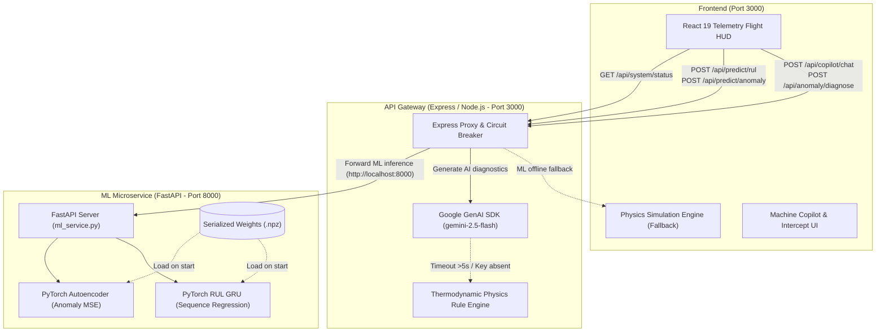

# SENTRY (PredictIQ) · Industrial IoT Predictive Maintenance Platform

[](https://www.typescriptlang.org/)
[](https://react.dev/)
[](https://fastapi.tiangolo.com/)
[](https://pytorch.org/)
[](https://ai.google.dev/)
[](LICENSE)

> **SENTRY (PredictIQ)** is an enterprise Industrial IoT Predictive Maintenance & Digital Twin Platform for mission-critical heavy machinery. It transitions industrial reliability from reactive emergency repair to condition-based intervention using real-time telemetry, deep learning, and generative AI copilot diagnostics.

---

## ⚡ The Core Problem

Unplanned industrial equipment failures inflict catastrophic economic and operational loss:
* **Catastrophic Outages:** Secondary equipment damage, emergency crane/crew dispatch, and rush supply logistics cost **\$250,000 to \$500,000+** per incident.
* **Conventional Blindspots:** Traditional calendar-based or run-to-failure schedules either replace healthy components prematurely or miss sub-surface micro-cracking and thermodynamic drift before alarms trigger.

---

## 🎯 Architecture Overview (Decoupled Microservice Gateway)



### 1. Two-Stage Deep Learning Pipeline
1. **Stage 1: Autoencoder Anomaly Detection**
   - Learns baseline correlations without requiring labeled failure datasets.
   - Computes real-time Reconstruction Mean Squared Error (MSE) across multidimensional sensor channels.
   - Flags an onset anomaly when MSE breaches the statistical $3\sigma$ baseline knee-point.
2. **Stage 2: Recurrent Sequence RUL Regression (GRU)**
   - Consumes multi-cycle sliding windows to regress Remaining Useful Life ($RUL$).
   - Computes a conservative 95% Confidence Interval based on NASA asymmetric error dispersion to eliminate catastrophic late-call risks.

### 2. Multi-Asset Fleet Coverage
* ✈️ **Aviation Turbofans (NASA C-MAPSS FD001):** High-pressure turbine outlet temp ($T_{50}$), compressor pressure ratio ($P_{30}$), rotor vibration RMS.
* ⚡ **High-Voltage Transformers:** Dissolved Gas Analysis ($\text{H}_2, \text{CH}_4$), top-oil temperature, dielectric insulation moisture.
* 💧 **Petrochemical Centrifugal Pumps:** Drive-end bearing temperature, suction cavitation pressure, seal blowby.
* ⚙️ **Wind Turbine Gearboxes:** Planetary gear tooth wear, oil particulate metal debris, high-speed shaft harmonics.

### 3. Dual-Layer Resilient Fallback
* **Gemini Offline Fallback:** If `GEMINI_API_KEY` is not configured or times out (>5s), the API gateway immediately serves high-fidelity deterministic thermodynamic physics diagnostics.
* **ML Offline Fallback:** If the Python ML service is paused, the web gateway and React HUD automatically switch to client-side physics simulation with zero stutter or crash.

---

## 🚀 Quickstart

### Prerequisites
* **Node.js:** v18+ (v20+ recommended)
* **Python:** v3.10–3.12 (optional if running via Docker)

### 1. Clone & Install
```bash
git clone https://github.com/your-org/sentry-predictiq.git
cd sentry-predictiq
npm install
```

### 2. Environment Variables
Copy `.env.example` to `.env` and configure your Gemini API Key (optional—fallback engine active without it):
```env
GEMINI_API_KEY=your_gemini_api_key_here
PORT=3000
```

### 3. One-Click Launch (Both Gateway & ML Microservice)
```bash
# Windows
start.bat

# Or via npm (Cross-platform)
npm run dev:all
```
* **Frontend Flight HUD & Gateway:** `http://localhost:3000`
* **Python ML Microservice:** `http://localhost:8000` (Docs: `http://localhost:8000/docs`)

---

## 🐳 Docker Deployment

Run the complete multi-container stack with a single command:
```bash
docker compose up --build
```

---

## 🧪 Testing & Verification

Run the verification test suites:
```bash
# ML Microservice Verification (PyTorch / Vectorized Engine)
npm run test:ml

# Typecheck Frontend & Server
npm run lint

# Production Bundle Build
npm run build
```

---

## 📡 REST API Reference

### Express Gateway (`http://localhost:3000`)
| Method | Endpoint | Description |
|---|---|---|
| `GET` | `/api/system/status` | System health, ML microservice status & AI engine status |
| `POST` | `/api/predict/anomaly` | Autoencoder anomaly reconstruction MSE & severity rating |
| `POST` | `/api/predict/rul` | Sequence GRU Remaining Useful Life regression & 95% CI |
| `POST` | `/api/copilot/chat` | GenAI Reliability Copilot diagnostic chat |
| `POST` | `/api/anomaly/diagnose` | Root-cause physical failure mode synthesis |

---

## ⚖️ License
MIT License. Built for critical industrial asset reliability.
